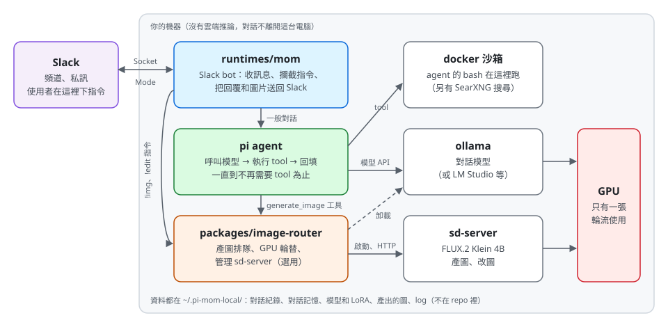

# pi-mom-local

把一個 Slack bot 接到**你自己機器上跑的模型**。沒有 API key，沒有雲端推論，對話不離開你的電腦。有 NVIDIA 顯示卡的話，還可以在本機產圖、改圖。



衍生自 [badlogic/pi-mono](https://github.com/badlogic/pi-mono) 的 `packages/mom`（MIT）。差在哪、為什麼要另開一個 repo，見 [NOTICE](NOTICE)。

**文件：**
- 這份 README：安裝和使用
- [RUNBOOK.md](RUNBOOK.md)：出問題時怎麼排查
- [docs/architecture.md](docs/architecture.md)：開發和 review 的入口，從那裡連到各模組

---

## 需要什麼

| | | |
| --- | --- | --- |
| **node** | >= 20；npm >= 11 | macOS：`brew install node`；Linux：nvm 或發行版套件 |
| **docker** | 給 agent 的 bash 用的沙箱 | [Docker Desktop](https://www.docker.com/products/docker-desktop/) 或 docker engine |
| **一個本地模型主機** | ollama / LM Studio / llama.cpp / vLLM 任一 | 見下方 |
| **一個 Slack workspace** | 你要有權限安裝 App | |
| NVIDIA 顯示卡（選用） | 產圖用，6GB VRAM 就夠 | 見「本機產圖」 |

在 macOS 和 Windows 的 WSL2（Ubuntu 22.04）上驗證過；產圖只在 WSL2 + RTX 2060 6GB 上驗證過。

---

## 安裝

### 1. 準備本地模型

以 **ollama** 為例（其他主機見「換一種模型主機」）：

```bash
ollama serve                      # 或開 Ollama.app
ollama pull gemma4:latest         # 換成你要用的模型
```

> ⚠️ **這一步做錯，agent 會表現得像壞掉一樣。**
> ollama 的 context window 預設只有 **4096 token**，超過就**靜默截斷**：不會報錯，只是把 prompt 前面砍掉，連 system prompt 裡的工具說明一起砍。
> 症狀是 agent 堅稱自己沒有任何工具，或整段回覆憑空消失。下一步的 `setup.sh` 會幫你建一個 context 加大的衍生模型。

### 2. 取得程式碼並初始化

```bash
git clone git@github.com:cyhkelvin/pi-mom-local.git
cd pi-mom-local
OLLAMA_BASE_MODEL=gemma4:latest bin/setup.sh
```

`setup.sh` 會依序做這些事，可以重複執行，做過的會跳過：
1. 檢查 node 和 docker。
2. 建立 `config/agent.env`。
3. 用 `num_ctx 32768` 建立衍生模型 `gemma4-32k`。
4. 安裝依賴並編譯 runtime。

### 3. 設定 Slack

到 https://api.slack.com/apps → **Create New App** → From scratch。

**a. Bot Token Scopes**（OAuth & Permissions，共 16 個）

```
app_mentions:read  channels:history  channels:join   channels:read
chat:write         files:read        files:write     groups:history
groups:read        im:history        im:read         im:write
mpim:history       mpim:read         mpim:write      users:read
```

按 **Install to Workspace**，複製 **Bot User OAuth Token**（`xoxb-` 開頭）。

**b. App-Level Token**（Basic Information → App-Level Tokens）：Generate Token and Scopes，加上 `connections:write`，複製 token（`xapp-` 開頭）。

**c. 開 Socket Mode**（Socket Mode → Enable Socket Mode = ON）：不需要任何公開網址，也不用 ngrok。

**d. 開 DM**（App Home → Show Tabs）：勾選 *Allow users to send Slash commands and messages from the messages tab*。

**e. 訂閱事件**（Event Subscriptions → Enable Events = ON，不用填 Request URL）

```
app_mention        必要
message.im         必要（DM）
message.channels   必要（頻道上下文）
message.groups     選用（私人頻道）
```

**f. 把兩個 token 填進設定檔**（`config/agent.env` 已被 `.gitignore` 擋住，不會進版控）

```
MOM_SLACK_APP_TOKEN=xapp-...
MOM_SLACK_BOT_TOKEN=xoxb-...
```

### 4. 啟動

```bash
bin/start.sh          # 前景執行，Ctrl-C 停止
```

到 Slack DM 這個 bot 打聲招呼。在頻道裡要用 `@你的bot` 提及，而且 **bot 必須先被邀請進該頻道**（`/invite @你的bot`）。

### 5. 常駐（選用）

```bash
bin/install-launchd.sh     # macOS
bin/install-systemd.sh     # Linux／WSL：systemd 使用者服務 + 每 5 分鐘的 watchdog
```

兩者都會在 bot 結束時自動重啟，watchdog 會處理「程式活著但 Slack 連線已斷」的情況。

---

## 在 Slack 上怎麼用

| 輸入 | 作用 |
| --- | --- |
| 一般對話（頻道裡要 `@bot`） | 對話模型回答，可以讀寫檔案、跑 bash（在沙箱裡）、搜尋網路 |
| `stop` | 中斷 bot 目前的回覆 |
| 「幫我畫一張……」 | 對話模型呼叫產圖工具（見「本機產圖」） |
| `!img`、`!edit`、`!lora` | 不經過對話模型，直接產圖、改圖、列出 LoRA |
| `/clear`、`/clear-record`、`!clear-slack`、`!clear-all` | 清除對話記憶、本機紀錄、Slack 上 bot 的訊息（見「清除對話」） |

> 私訊裡 Slack 會把 `/` 開頭的訊息當成 slash command 擋下。所有 `/` 開頭的指令都可以改用 `!`，例如 `!clear`。

---

## 本機產圖（選用）

用你自己的顯示卡產圖和改圖。模型是 **FLUX.2 Klein 4B**（Q4 GGUF），文字編碼器是 **abliterated 的 Qwen3-4B**，透過 [stable-diffusion.cpp](https://github.com/leejet/stable-diffusion.cpp) 的 `sd-server` 執行。為 6GB VRAM 設計：產圖時先把對話模型從 GPU 卸載，產完再交回來。

### 設定

```bash
bin/image-setup.sh             # 下載模型（約 5GB）、比對 sha256、檢查 sd-server
$EDITOR config/agent.env       # IMAGE_ENABLED=1
bin/stop.sh && bin/start.sh
```

`sd-server` 要自己編譯，因為 release 沒有 Linux CUDA 版。步驟見 [packages/image-router 的「編譯 sd-server」](packages/image-router/README.md#編譯-sd-server)。

### 指令

| 在 Slack 打 | 會發生什麼 |
| --- | --- |
| 「幫我畫一張……」 | bot 呼叫 `generate_image`，回你預估時間，產完貼圖 |
| `!img <描述> [--size 768x1024] [--steps 4] [--seed 42] [--lora｜--loraN] [--nsfw]` | 不經過對話模型，直接產圖。768×1024 約 40 秒，第一張要多約 20 秒載入 |
| 上傳照片，同一則打 `!edit <要怎麼改> [--size …] [--lora]` | 用文字修改照片，中文也可以，例如 `!edit 把雪鏡換成細框眼鏡`。沒附照片時改這個頻道最近一張圖（包括 bot 剛產的）。約 1–1.5 分鐘 |
| `!lora` | 列出 LoRA 和編號 |
| 產圖中打任何話 | 回「正在產圖（誰在哪個頻道觸發）x/N 步、已跑、剩約」 |
| `等待`／`進度` | 查看進度 |
| `stop`／`取消` | 中斷產圖（限觸發者本人或同一個頻道） |

- **產圖期間所有頻道都不能對話**，因為 GPU 只有一張。
- **失敗時交回 bot 說明：** OOM、逾時、sd-server 當掉、全白或全黑的圖，bot 會說明原因和已經花掉的時間。
- **連續產圖較快：** 產完 sd-server 會再常駐 10 分鐘（`IMAGE_KEEP_ALIVE`），不必重新載入；有人要對話時就先關掉，讓出 GPU。
- **`--nsfw`（選用，預設停用）：** 套用成人內容 LoRA，每張多約 14 秒。要用的話先 `CIVITAI_TOKEN=… bin/image-setup.sh --with-nsfw` 下載，再在 `config/agent.env` 設 `IMAGE_NSFW_LORA`。只用在文字描述的虛構成人。
- **`!edit` 的限制：** 不支援 `--nsfw`。修改說明含裸露、脫衣、性感化字眼時直接拒絕，因為上傳的照片可能是真人（這是關鍵字過濾，不是完整的內容審查）。
- **禁止的用途：** 不要用來仿冒真實人物，也不要產生任何涉及未成年人的性化內容。

### 模型和 LoRA 放哪裡

```
~/.pi-mom-local/models/image/flux2/            IMAGE_MODEL_DIR
├── flux-2-klein-4b-Q4_0.gguf                  主模型
├── Qwen3-4B-abliterated.Q4_K_M.gguf           文字編碼器
├── flux2-klein-vae.safetensors                VAE
├── loras/                                     一般 LoRA（--lora）
│   ├── asian_mix.safetensors                  ← --lora1（沒設 IMAGE_LORA 時也是 --lora）
│   └── european/                              一包多個檔案可以放子資料夾
│       ├── face_v2.safetensors                ← --lora2
│       └── face_v10.safetensors               ← --lora3
└── nsfw/                                      NSFW LoRA（--nsfw，選用）
    └── party_time_v2.1_klein4b.safetensors    ← IMAGE_NSFW_LORA（預設不下載）
```

- **LoRA 要對應 FLUX.2 Klein 4B：** Civitai 的 Base Model 標籤要是 `Flux.2 Klein 4B`，其他模型的 LoRA 不能用。
- **放進 `loras/` 就能用：** 不用重啟。編號依「子資料夾/檔名」排序（`v2` 排在 `v10` 前面），新增或刪除檔案後編號會變，打 `!lora` 看目前的編號。
- **`--lora` 用哪一個：** 用 `config/agent.env` 的 `IMAGE_LORA`，沒設就是第 1 個。`--lora3` 但只有兩個檔案時，這張不套 LoRA，照常產圖並註明。
- **權重：** `IMAGE_LORA_WEIGHT` 預設 0.6。一次只套一個一般 LoRA，可以和 `--nsfw` 一起用。記得在描述裡寫 LoRA 的觸發詞（Civitai 頁面的 Trigger Words）。
- **NSFW LoRA 只能放 `nsfw/`：** 不要放進 `loras/`；`!edit` 也不會套用檔名像 NSFW 的 LoRA。`loras/` 和 `nsfw/` 要在同一層。
- **權重檔不進版控。**

---

## 清除對話

舊對話會讓模型照抄過時的回答，例如它以前說過「我無法生成圖片」，產圖上線後還是照樣拒絕。下面這些指令只影響下指令的那個頻道，不經過對話模型。

| 指令 | 清除 | 保留 |
| --- | --- | --- |
| `/clear` | bot 的對話記憶，bot 從頭開始 | 本機紀錄、Slack 上的訊息、`MEMORY.md` |
| `/clear-record` | 對話記憶和本機紀錄（訊息紀錄、附件） | Slack 上的訊息、`MEMORY.md` |
| `!clear-slack` → `!clear-slack confirm` | Slack 上 bot 發過的訊息（含討論串回覆）和 bot 上傳的圖片 | 你自己的訊息、本機的一切 |
| `!clear-all` → `!clear-all confirm` | 以上全部：先刪 Slack 上 bot 的訊息，再清對話記憶和本機紀錄 | 你自己的訊息、`MEMORY.md` |

**只清一段：** 四個指令都可以加一個範圍，只清某個時間點到現在的，不加就是全部。

| 參數 | 意思 | 例子 |
| --- | --- | --- |
| `--since 日期 [時間]` | 這個時間點以後的。日期可以寫 `2026-11-20`、`2026/11/20`、`11-20`；時間是 `HH:MM` | `/clear --since 11-20`、`!clear-all --since 2026-11-20 15:00` |
| `--last N` | 最近 N 則。清除指令本身和 bot 的確認說明不算 | `/clear-record --last 30`、`!clear-slack --last 100` |

- **刪了無法復原。** `!clear-slack`、`!clear-all` 第一次只回說明，附上完整的 confirm 指令，複製回覆才會真的刪。
- **你自己的訊息要自己刪：** Slack 不允許 bot 刪別人的訊息。
- **Slack 刪除比較慢：** Slack 每分鐘只能刪約 50 則，訊息多的頻道要等幾分鐘；刪完的通知 1 分鐘後自動消失。
- **bot 在忙時不能清：** bot 回覆中或產圖中會拒絕執行，請稍後再試。
- **想全部清乾淨：** 用 `!clear-all`，它最後才清本機，連清除過程中打的指令也一起清掉。

---

## 日常操作

```bash
bin/status.sh         # 現在是什麼情況（排查第一步），含 sd-server 和 VRAM
bin/start.sh          # 啟動
bin/stop.sh           # 停止（也會收掉 sd-server）
bin/probe.sh          # 直接測模型會不會呼叫工具（繞過 mom 與 Slack）
bin/backup.sh         # 備份對話
bin/rotate-logs.sh    # 日誌容量控管
bin/check-upstream.sh # 上游有沒有更新
bin/searxng.sh        # 自架搜尋引擎（search 工具用）
bin/image-setup.sh    # 本機產圖：下載模型、檢查 sd-server
```

出問題時照 [RUNBOOK.md](RUNBOOK.md) 排查。

---

## 換一種模型主機

`config/hosts/` 每個 JSON 就是一種主機，`config/agent.env` 裡的 `HOST=` 決定用哪個。

| `HOST` | 預設位址 | 怎麼啟動 |
| --- | --- | --- |
| `ollama` | `localhost:11434/v1` | `ollama serve` |
| `lmstudio` | `localhost:1234/v1` | LM Studio → Developer 分頁 → Start Server |
| `llamacpp` | `localhost:8080/v1` | `llama-server -m model.gguf -c 32768` |
| `vllm` | `localhost:8000/v1` | `vllm serve <model>` |

除了 ollama 之外的三個是骨架，`id` 要改成你實際載入的模型名稱。

產圖前自動把對話模型移出 GPU 的功能，目前只支援 ollama。用其他主機時，要自己確保產圖時 VRAM 夠用。

**加一種新的主機：** 放一個 `config/hosts/<名字>.json`，provider key 和檔名同名，然後設 `HOST=<名字>`。不用改任何程式碼。

> ⚠️ **`contextWindow` 一定要填，而且要跟模型主機的實際設定一致。**
> 沒填的話 pi 會假設 128000，於是送出遠超過主機能吃的 prompt，然後被靜默截斷，就是上面講的那個症狀。

---

## 資料放哪

預設在 `~/.pi-mom-local/`，可以用 `config/agent.env` 的 `STATE_DIR` 改：

| 目錄 | 內容 |
| --- | --- |
| `channels/` | Slack 對話紀錄，每個頻道一個資料夾 |
| `workspace/` | 掛進沙箱容器的 `/workspace`；產出的圖在 `images/` |
| `models/image/` | 產圖模型和 LoRA |
| `home/` | 隔離用的 `HOME`，讓 agent 讀不到你自己的憑證 |
| `logs/` | 執行日誌（`mom.log`、`sd-server.log`） |
| `backup/` | `bin/backup.sh` 的產出 |

**全部在 repo 之外**，所以不可能誤 commit 進版控。完整清單見 [docs/architecture.md](docs/architecture.md#資料放哪)。

---

## 安全性

**agent 的 bash 跑在 docker 容器裡。** 這不是可選項：Slack 工作區裡**任何人**都能對這個 bot 下指令，而模型確實會呼叫工具。`SANDBOX=host` 等於把你機器上的 shell 開放給整個工作區，只該用於除錯。

**思考內容只進討論串，不進主頻道。** 推理會帶出最終回答刻意省略的東西（檔案路徑、system prompt、記憶、其他訊息的 context）。主頻道裡人人可見，等於把偵察面攤開給潛在的 prompt injection。這是本 repo 和上游的差異之一。

**憑證隔離。** agent 跑在一個獨立的 `HOME` 底下，讀不到你的 `~/.pi`、`~/.ssh`、`~/.aws`。

**產圖只聽本機。** sd-server 只綁定 `127.0.0.1`；模型和 LoRA 權重都不進版控。

**產圖的使用責任。** 文字編碼器是去審查版，所以模型本身幾乎不拒絕任何描述；限制都在 bot 這一層，而且只是盡力而為：
- `--nsfw` 預設停用，要自己下載、設定才會開啟。
- `!edit` 不接受 `--nsfw`，也拒絕裸露、性感化的修改說明，因為上傳的照片可能是真人。這是關鍵字過濾，不是完整的內容審查。

架設的人要為工作區裡的使用方式負責：
- 不要用來仿冒真實人物。
- 不要產生任何涉及未成年人的性化內容。
- 遵守模型和 LoRA 各自的授權。

---

## 開發和維護

- **[docs/architecture.md](docs/architecture.md)：** repo 分層（`bin/`、`packages/`、`runtimes/`）、runtime 和套件的契約、程序和 GPU、資料位置、建置和測試、新增 runtime 的步驟。
- **[packages/image-router/README.md](packages/image-router/README.md)：** 產圖模組的介面、流程、檔案導讀、設定、**本機怎麼測模型**、編譯 sd-server。
- **[runtimes/mom/README.md](runtimes/mom/README.md)：** Slack runtime 的訊息流程、指令攔截順序、檔案地圖、測試。
- **[runtimes/mom/docs/clear-commands.md](runtimes/mom/docs/clear-commands.md)：** 清除指令的設計。

---

## 授權

MIT。原始著作權 © 2025 Mario Zechner，見 [LICENSE](LICENSE) 與 [NOTICE](NOTICE)。
