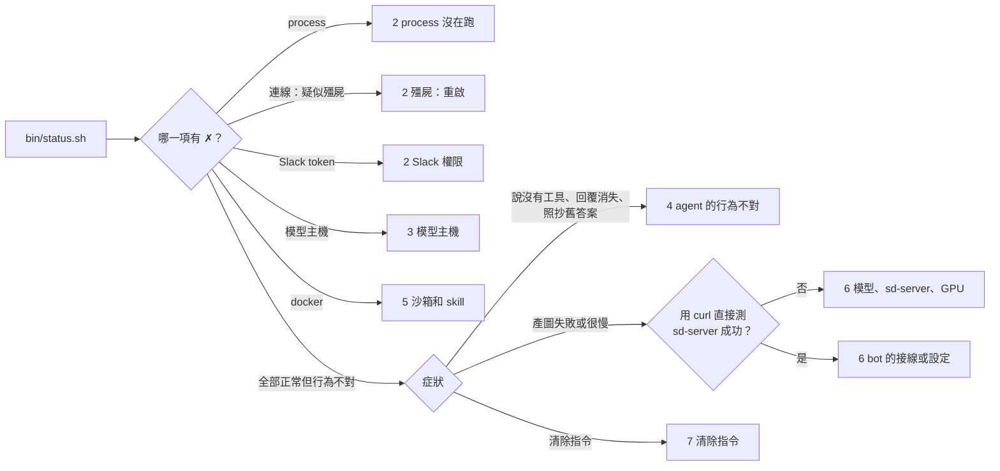

# RUNBOOK：出問題時怎麼排查

**照順序做，由便宜到昂貴。** 先跑 `bin/status.sh`，再依它報的元件跳到對應的段落。



- [0. 先跑 status.sh](#0-先跑-statussh)
- [1. 讀 log](#1-讀-log)
- [2. Slack 連線](#2-slack-連線)
- [3. 模型主機](#3-模型主機)
- [4. agent 的行為不對](#4-agent-的行為不對)
- [5. 沙箱和 skill](#5-沙箱和-skill)
- [6. 產圖](#6-產圖)
- [7. 清除指令](#7-清除指令)

---

## 0. 先跑 status.sh

```bash
bin/status.sh
```

一次檢查這些項目，下面每一節對應它可能報出的一種失敗：
- process
- Socket Mode 連線健康度
- 模型主機
- docker 容器
- Slack token
- 最後一則對話的時間
- sd-server 是否常駐、VRAM 用量、產圖預估時間的統計

常駐方式：
- **macOS：** launchd。
- **Linux／WSL：** systemd 使用者服務 `pi-mom`，用 `systemctl --user status pi-mom` 看狀態。

兩者都會在 bot 結束後自動重啟，所以 `bin/stop.sh` 之後它會自己起來。

---

## 1. 讀 log

```bash
tail -50 ~/.pi-mom-local/logs/mom.log
grep -iE "error|failed|✗" ~/.pi-mom-local/logs/mom.log
journalctl --user -u pi-mom -n 50          # systemd 常駐時
```

一次正常的往返長這樣：

```
[system] Starting run: <使用者的訊息>
[system] Context sizes - system: N chars, memory: N chars
→ Streaming response...
💬 Response          ← 有這行才是真的答完了
```

| 你看到 | 意思 |
| --- | --- |
| 有 `Starting run` 沒有 `→ Streaming` | 模型沒回應 → 第 3 節 |
| 有 `→ Streaming`、只有 `💭 Thinking` 沒有 `💬 Response` | context 爆了 → 第 4 節 |
| 有 `↳ <tool>`／`✓ <tool>` | 工具有被呼叫，容器那側正常 |
| `Skipping old message (pre-startup)` | 正常，啟動前的舊訊息不處理 |
| `[image] …` | 產圖的流程紀錄 → 第 6 節 |
| `clear-slack：刪除 N 則…`、`clear-record：刪除 …` | 清除指令的結果 → 第 7 節 |

對話紀錄：

```bash
jq -r '"[\(.date)] \(.userName // "bot"): \(.text)"' ~/.pi-mom-local/channels/<頻道ID>/log.jsonl | tail -20
```

---

## 2. Slack 連線

### process 在跑，但一則訊息都收不到（殭屍）

**這是最會騙人的一種。** `status.sh` 的 process、模型主機、容器、token 四項可能全綠，但 bot 就是不回應：Socket Mode 連線在休眠時斷了，重連失敗後一直空轉。連 TCP 層都看不出來，殭屍狀態下 `lsof` 仍會顯示一條 ESTABLISHED 連線。

`status.sh` 會直接告訴你：

```
連線     : 連線後錯誤 26 次、收到訊息 0 則 （啟動後系統曾於 09-05 15:19 從休眠喚醒）
✗ 疑似殭屍：process 活著但沒收過任何訊息，且有連線錯誤。
  → bin/stop.sh && bin/start.sh
```

判定規則看「最後一次連線成功**之後**」的兩個計數：

| 錯誤數 | 訊息數 | 判定 |
| --- | --- | --- |
| >0 | 0 | **殭屍**，重啟 |
| >0 | >0 | 曾斷線但已恢復，不用動 |
| 0 | — | 正常 |

watchdog（launchd 或 systemd timer，每 5 分鐘）會自動處理這種情況。

> **重啟後你要重發訊息。** 中斷期間你打的字會被補進歷史，但 mom 設計上不處理啟動前的訊息。

### process 沒在跑

```
✗ process 沒在跑 → bin/start.sh
```

直接 `bin/start.sh`。如果它立刻退出，看它印出的錯誤：`bin/lib.sh` 的檢查都會講清楚缺什麼。建置失敗（例如 `Cannot find package`）就跑 `runtimes/mom/build`，看哪一步出錯。

### Slack 權限

```
✗ Slack token 無效：invalid_auth
```

| 症狀 | 修法 |
| --- | --- |
| `invalid_auth`／`token_revoked` | 到 https://api.slack.com/apps 重新產生，更新 `config/agent.env` |
| token 有效但頻道裡沒反應 | bot 不是該頻道成員。mom 只看它**是成員**的頻道 → `/invite @你的bot` |
| DM 沒反應 | App Home → Show Tabs → 允許使用者從 messages tab 傳訊 |
| `missing_scope` | 16 個 bot scope 沒加齊，補完要 **Reinstall to Workspace** |
| 私訊裡 `/clear`、`/img` 被 Slack 說「不是有效的指令」 | Slack 把 `/` 開頭當 slash command → 改打 `!clear`、`!img` |

> **同一組 token 起兩個 Socket Mode 連線會互搶訊息**，症狀是回覆隨機消失。`bin/start.sh` 有 pidfile 防護，但如果你曾手動起過，先 `bin/stop.sh` 清乾淨。

---

## 3. 模型主機

```
✗ ollama 沒有回應（http://localhost:11434/v1）
```

| 主機 | 怎麼起 |
| --- | --- |
| ollama | `ollama serve`（macOS 也可以 `open -a Ollama`） |
| lmstudio | LM Studio → Developer → Start Server |
| llamacpp | `llama-server -m model.gguf -c 32768` |
| vllm | `vllm serve <model>` |

模型還在嗎：

```bash
ollama list | grep "$(grep '^LLM_MODEL=' config/agent.env | cut -d= -f2)"
ollama ps          # 有沒有載入、是不是 100% GPU
```

`ollama ps` 顯示一部分在 CPU 時，回覆會慢好幾倍。常見原因是 sd-server 還佔著 VRAM，見第 6 節。

---

## 4. agent 的行為不對

### 說自己沒有工具，或回覆整段消失

**這幾乎一定是 context window 的問題，重啟不會好。** 模型主機的實際 context 比送進去的 prompt 小，於是**靜默截斷**：不報錯，只是把 prompt 前面砍掉，連 system prompt 裡的工具說明一起砍。

先量：

```bash
wc -c ~/.pi-mom-local/channels/<頻道ID>/last_prompt.jsonl
```

拿這個數字對照兩件事，**兩邊都要夠大**：

| 要對照 | 在哪 |
| --- | --- |
| 模型主機的實際 context | ollama：`ollama show <模型>` 的 `num_ctx` |
| pi 以為的 context | `config/hosts/<host>.json` 的 `contextWindow` |

ollama 加大的做法：

```bash
printf 'FROM gemma4:latest\nPARAMETER num_ctx 32768\n' | ollama create gemma4-32k -f -
```

然後把 `config/hosts/ollama.json` 的 `contextWindow` 改成同一個數字，`config/agent.env` 的 `LLM_MODEL` 改成 `gemma4-32k`，重啟。

> 參考數字：一次 48,745 bytes 的 prompt 配上 4096 的 `num_ctx`，就會出現「agent 堅稱自己沒有工具」和「回覆消失」這兩個症狀。

### 照抄過時的回答（例如堅稱「無法產圖」）

舊對話留在記憶裡，模型會跟著照抄。用 `/clear` 清掉這個頻道的對話記憶（見 README「清除對話」）。

### 確認工具真的能用（四個測試）

**「它能說出自己有哪些工具」不等於「它會呼叫工具」。** 前者只證明 system prompt 沒被截斷，後者才是真的能做事。要區分兩者，用一個猜不到的隨機驗證碼：

```bash
TOKEN="pi-$(openssl rand -hex 6)"
printf '這是 tool-calling 測試檔。\n驗證碼：%s\n' "$TOKEN" > ~/.pi-mom-local/workspace/canary.txt
```

在 Slack DM bot，照順序問：

| # | 問什麼 | 通過的樣子 |
| --- | --- | --- |
| 1 | 讀 `/workspace/canary.txt` 的內容，把驗證碼告訴我 | 回出正確的隨機碼 |
| 2 | 執行 `uname -a` 並告訴我結果 | 含 `Linux`／`alpine`。出現 `Darwin` 或你的主機名稱，代表沙箱沒生效 |
| 3 | 在 `/workspace` 建立 `hello.txt`，內容寫 `from slack` | host 端 `cat ~/.pi-mom-local/workspace/hello.txt` 對得上 |
| 4 | 列出 `/Users`（或 `/home`）底下的檔案 | **找不到你的個人目錄才是對的**。真的列出來代表隔離破功 |

要先確認問題出在模型還是 mom，跑 `bin/probe.sh`：它直接打模型主機，繞過 mom 和 Slack。
- **probe 過、Slack 不過：** 問題在 mom、prompt 或 context。
- **probe 就不過：** 問題在模型或它的 context 設定。

---

## 5. 沙箱和 skill

### 容器有問題

```
✗ docker daemon 沒起來
✗ 容器 pi-mom-sandbox 不存在
```

- **daemon 沒起來：** macOS 用 `open -a Docker`，Linux 用 `sudo systemctl start docker`，等 10–30 秒。
- **容器不存在：** 不用手動建，`bin/start.sh` 會建。

確認容器真的能動、能上網：

```bash
docker exec pi-mom-sandbox sh -c 'ls -la /workspace && wget -qO- -T5 https://example.com >/dev/null && echo 可上網'
```

沙箱 image 由 `sandbox/Dockerfile` 建出來（alpine + `curl` `lynx` `jq`）。`start` 用 Dockerfile 的內容雜湊當 image label，改了才重建。要強制重建：

```bash
docker rmi pi-mom-sandbox:local && bin/stop.sh
```

### skill 和網路查詢

`search`、`fetch` 是工具，背後是 repo 的 `skills/`：

| skill | 做什麼 | 需要憑證 |
| --- | --- | --- |
| `fetch` | 網址 → 純文字（`lynx -dump`），上限 12000 bytes | 否 |
| `search` | 關鍵字 → 標題、網址、摘要，最多 5 筆 | 預設的 SearXNG 不用 |

**skill 為什麼放兩個地方：** 載入端和執行端不是同一個路徑。
- **載入：** `agent.ts` 讀 host 的 `$STATE_DIR/channels/skills/`。
- **執行：** agent 的 bash 在容器裡，看到的是 `/workspace/skills/`。

`runtimes/mom/start` 用一條額外的掛載把兩端指到同一份檔案，並在每次啟動時把 repo 的 `skills/` 同步過去。同步會覆蓋同名目錄，agent 自建的其他 skill 不動。**所以要改內建 skill 就改 repo 裡的 `skills/`**，`$STATE_DIR` 底下那份下次啟動會被蓋掉。

**SearXNG（預設，不需要 key）：**

```bash
bin/searxng.sh up        # 啟動（第一次會拉 image）
bin/searxng.sh status
bin/searxng.sh test      # 直接打一次 JSON API，確認設定沒壞
bin/searxng.sh down
```

`SEARCH_PROVIDER=searxng` 時 `runtimes/mom/start` 會自動帶起來。`sandbox/searxng/settings.yml` 有兩個一定要知道的設定：
- **`search.formats` 必須含 `json`：** 預設只有 html，不加的話 API 回 403 而且不說原因。這是最常踩的坑。
- **`server.limiter: false`：** limiter 是擋機器人的，開著時用 curl 打會被 429。敢關的前提是這個實例沒有 publish 到主機埠，只掛在 docker 內網 `pi-mom-net` 上。

SearXNG 是 metasearch，代你去問 Google、Bing 等上游引擎，量一大會吃到 CAPTCHA 或 429。個人用量沒問題。

**改用 brave 或 tavily：**
1. 申請一組 key，兩家都要綁卡：
   - Brave（<https://api.search.brave.com/app/keys>）：每月 $5 免費額度，約 1,000 次。
   - Tavily（<https://app.tavily.com/home>）：每月 1,000 credits。
2. 填進 `config/agent.env` 的 `BRAVE_SEARCH_API_KEY` 或 `TAVILY_API_KEY`，並把 `SEARCH_PROVIDER` 設成對應的那一個。
3. `bin/stop.sh`，讓常駐服務重啟。start 會發現憑證雜湊變了，自己重建容器。

⚠ **key 注入容器之後，agent 的 bash 讀得到它。** 只放搜尋用的免費額度 key，不要放任何有金錢或資料權限的憑證。

測試：`bash tests/skills_test.sh`（需要 docker）。

---

## 6. 產圖

```bash
bin/status.sh                                   # sd-server 是否常駐、VRAM、預估時間統計
tail -50 ~/.pi-mom-local/logs/sd-server.log      # sd-server 本身的輸出
grep '\[image\]' ~/.pi-mom-local/logs/mom.log | tail -20
nvidia-smi                                      # 誰佔著 GPU
```

**先確認問題在模型還是 bot：** 照 [packages/image-router 的「直接測 sd-server」](packages/image-router/README.md#2-直接測-sd-server需要-gpu-和模型不經過-bot)，用 curl 直接產一張。
- **curl 也失敗：** 問題在模型、sd-server 或 GPU。
- **curl 成功：** 問題在 bot 的接線或設定。

| 症狀 | 原因 | 處理 |
| --- | --- | --- |
| 回「產圖功能沒有啟用」 | `IMAGE_ENABLED` 不是 1 | 改 `config/agent.env` 後重啟 |
| 失敗：「找不到 sd-server」 | 還沒編譯，或 `IMAGE_SD_SERVER_BIN` 路徑錯 | 見 [編譯 sd-server](packages/image-router/README.md#編譯-sd-server) |
| 失敗：「VRAM 不足」 | 有別的程式佔著顯示卡（另一個 ollama 模型、遊戲、殘留的 sd-server） | `nvidia-smi` 看是誰；`ollama ps`；`bin/stop.sh` 會清殘留的 sd-server |
| 失敗：「產圖模型載入失敗」 | 模型檔壞了或格式不對（例如 city96 版的 GGUF 只能給 ComfyUI 用） | `bin/image-setup.sh` 重新比對 sha256；看 sd-server.log |
| 失敗：CUDA out of memory | 解析度太大 | 降到 768×1024 以下；確認 `IMAGE_RESIDENT_MODE=ram` |
| 失敗：全白、全黑、單色圖 | VAE 或模型精度問題 | 換 VAE 檔；確認用的是 Klein（不是 Klein Base） |
| bot 一直回「正在產圖」但沒進度 | 卡住 | 觸發者回 `stop`；10 秒沒反應會強制 kill。逾時上限是 max(預估 × 3, 180 秒) |
| 產完圖後，對話變很慢 | sd-server 還佔著 VRAM，對話模型被擠一部分到 CPU | 正常情況 bot 會在對話前關掉它並重新載入對話模型；`ollama ps` 仍不是 100% GPU 時 `bin/stop.sh` |
| `--nsfw` 回「沒有設定 NSFW LoRA」 | NSFW LoRA 是選用的，預設停用 | 要用的話 `CIVITAI_TOKEN=… bin/image-setup.sh --with-nsfw`，再設 `IMAGE_NSFW_LORA` 後重啟 |
| `--lora`／`--nsfw` 回「找不到 LoRA 檔案」 | 檔案不在 `flux2/loras/`、`flux2/nsfw/`，或 `IMAGE_LORA` 檔名打錯 | 照訊息裡的路徑放好檔案，或把 `IMAGE_LORA` 留空後重啟 |
| `--lora2` 套到的不是想要的那個 | 編號依檔名排序，新增或刪除檔案後會變 | 打 `!lora` 看目前的編號 |
| `--lora`／`--nsfw` 回「要放在同一層」 | `IMAGE_LORA_DIR` 和 `IMAGE_NSFW_DIR` 指到不相干的地方 | 兩個資料夾放在同一個上層底下 |
| 套了 `--lora` 但看不出差別 | 沒寫觸發詞、權重太低，或不是 Klein 4B 用的 LoRA | 描述加上觸發詞；`IMAGE_LORA_WEIGHT` 調到 0.8–1.0；sd-server.log 搜尋 `LoRA tensors have been applied` |
| `!edit` 回「下載失敗」或「不是 PNG、JPEG 或 WebP」 | bot 沒有 `files:read`，或檔案格式不支援 | 補 scope 後 Reinstall；改傳 JPG 或 PNG |
| `!edit` 沒附照片卻說「還沒有可以修改的圖」 | 「最近一張圖」只放在記憶體，bot 重啟過 | 重新附上照片 |

產圖時間的預估會從實測學習（`~/.pi-mom-local/image-stats.json`），刪掉這個檔就回到預設值。

---

## 7. 清除指令

| 症狀 | 原因 | 處理 |
| --- | --- | --- |
| 回「助理還在回覆」或「正在產圖」 | bot 在忙時不能清 | 等它結束，或先打 `stop` |
| `!clear-slack` 只回說明、沒有刪 | 要再加 `confirm` | 複製說明裡附的 confirm 指令回覆 |
| 刪很久 | Slack 每分鐘只能刪約 50 則；log 出現 `rate limit` 是正常的，會自己重試 | 等它回「已刪除…」 |
| 完成通知說「N 則刪不掉」 | 細節在 log：`grep 'clear-slack 失敗' ~/.pi-mom-local/logs/mom.log` | 多半是權限或訊息類型的限制，手動刪 |
| Slack 上還有訊息 | 那些是你自己發的，bot 不能刪別人的訊息 | 手動刪 |
| 參數錯誤時 bot 回用法說明 | `--since` 的日期格式不對、日期還沒到、`--since` 和 `--last` 同時用 | 照用法改 |
| `/clear` 之後 bot 還記得舊事 | `MEMORY.md` 不會被清（那是 bot 刻意記下的長期筆記） | 要清就手動編輯 `~/.pi-mom-local/channels/<頻道ID>/MEMORY.md` |

設計細節見 [runtimes/mom/docs/clear-commands.md](runtimes/mom/docs/clear-commands.md)。
