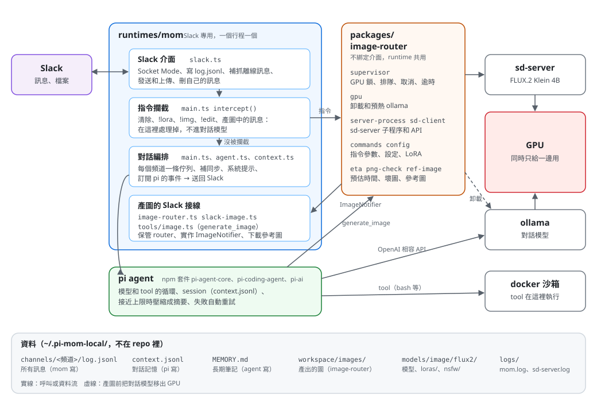
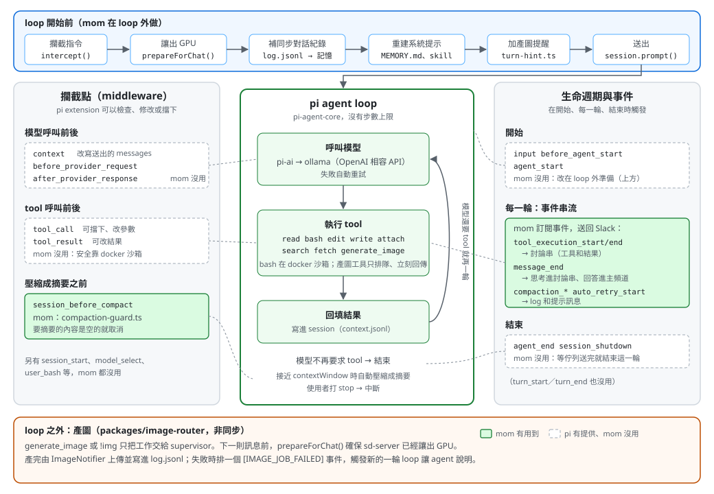
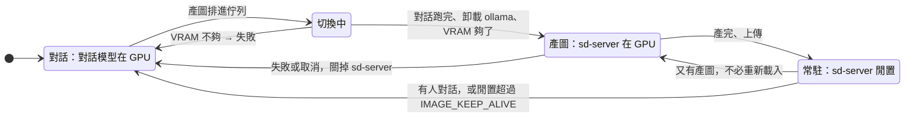

# 架構

給 review、維護和要新增部署方式的人看。安裝和使用見根目錄 [README](../README.md)，排錯見 [RUNBOOK](../RUNBOOK.md)。

## 架構總圖



一則 Slack 訊息從左上進來，依序經過 mom 的四個部分；對話交給 pi，產圖交給 image-router。各層的分工：

- **Slack 介面**（`slack.ts`）：唯一直接碰 Slack API 的地方。收事件時先寫進 `log.jsonl`，所以就算 bot 正在忙或離線，訊息也不會漏，之後補同步進對話記憶。
- **指令攔截**（`main.ts` 的 `intercept()`）：清除、`!lora`、`!img`、`!edit` 和產圖中的訊息，都在這裡處理掉，不進對話模型。指令的行為因此是確定的，不受模型影響。
- **對話編排**（`main.ts`、`agent.ts`、`context.ts`）：每個頻道一條佇列。每一輪開始前補同步、重建系統提示，然後交給 pi；訂閱 pi 的事件，把回答、思考和 tool 過程送回 Slack。
- **pi agent**（npm 套件，未修改）：模型和 tool 的循環、session、壓縮、重試。mom 掛在哪些點上，見下面「pi agent loop 與掛勾點」。
- **image-router**（`packages/`）：GPU 鎖、sd-server、產圖參數。不知道 Slack 的存在，發訊息和上傳圖片都透過 runtime 實作的 `ImageNotifier`。
- **外部程序**：ollama（對話模型）、sd-server（產圖）、docker 沙箱（tool 執行）。ollama 和 sd-server 輪流使用同一張 GPU。
- **資料**：全部在 `~/.pi-mom-local/`，每個檔案只有一個主要寫入者，見最下排和「資料放哪」。

## 分層

```
pi-mom-local/
├── bin/ config/ sandbox/ skills/ tests/   共用層：安裝、啟動、設定、沙箱、shell 測試
├── docs/                                  跨層的文件（這份）
├── packages/                              模組層：不綁定聊天介面的功能
│   └── image-router/                      本機產圖：GPU 輪替、sd-server、產圖參數
└── runtimes/                              部署層：一種介面一個資料夾
    └── mom/                               Slack bot（目前唯一的 runtime）
```

| 層 | 放什麼 | 不放什麼 |
| --- | --- | --- |
| 共用層 | 不管用哪個 runtime 都一樣的東西：`bin/` 腳本、`config/agent.env`、`config/hosts/`、模型下載（`bin/image-setup.sh`）、docker 沙箱、內建 skill | TypeScript 程式 |
| `packages/<名字>/` | 可以給多個 runtime 共用的 TypeScript 模組。只依賴 Node 內建模組或明確列出的套件，用介面和 runtime 溝通 | Slack 等任何聊天介面的程式；全域單例 |
| `runtimes/<名字>/` | 一種介面的完整 bot：收訊息、接 agent、把結果送回介面 | 可以共用卻寫死在這裡的邏輯 |

**依賴方向只能往下：** `runtimes/* → packages/* → Node 內建模組`。
- `packages/` 不能 import `runtimes/`。
- 套件之間也不互相 import。
- 套件需要介面的地方（發訊息、上傳圖片），由 runtime 傳實作進去。

### 文件放哪

| 文件 | 讀者 | 內容 |
| --- | --- | --- |
| `README.md` | 使用者 | 安裝、設定、Slack 指令 |
| `RUNBOOK.md` | 維運 | 依元件分類的排錯 |
| `docs/architecture.md` | 開發、review | 分層、契約、資料位置（這份） |
| `packages/<名字>/README.md` | 開發、review | 套件的介面、流程、檔案導讀、設定、本機測試 |
| `runtimes/<名字>/README.md`、`runtimes/<名字>/docs/` | 開發、review | runtime 的接線、檔案地圖、測試；runtime 專屬功能的設計 |

設計過程和試錯的紀錄不放進 repo，放在 GitHub issue。

## runtime 契約

`runtimes/<名字>/` 底下放三個檔案就是一個 runtime，`config/agent.env` 的 `RUNTIME=<名字>` 決定用哪個（預設 `mom`）。

| 檔案 | 契約 |
| --- | --- |
| `build` | 可執行、冪等。安裝依賴並編譯；用到 `packages/*` 時要先建置它們 |
| `start` | 可執行。由 `bin/start.sh` 呼叫，設定從環境變數拿：`CHANNELS_DIR` `WORKSPACE` `PI_HOME` `SANDBOX` `SANDBOX_IMAGE` `MOM_MODELS_JSON` `LLM_PROVIDER` `LLM_MODEL`，以及 `config/agent.env` 裡的其他變數（`MOM_SLACK_*`、`IMAGE_*`…） |
| `README.md` | 這個 runtime 的來源、接線和測試 |

這是一個**分派約定，不是插件框架**：不做介面檢查、不做版本協商。`bin/start.sh` 負責讀設定、寫 pidfile 和 log，然後 `exec runtimes/$RUNTIME/start`。

以後新增介面（例如命令列版），就是新增 `runtimes/cli/`，在它的 `package.json` 依賴需要的套件，不必動 `runtimes/mom/`。

## 套件契約

| 項目 | 規則 |
| --- | --- |
| 名稱 | `@pi-mom-local/<名字>`，`"private": true` |
| 依賴方式 | runtime 的 `package.json` 寫 `"@pi-mom-local/<名字>": "file:../../packages/<名字>"`，npm 會建立連結 |
| 建置 | 自己的 `package.json`、`tsconfig.json`，輸出到 `dist/`（不進版控）；runtime 的 `build` 先建置它 |
| 測試 | 自己的 `test/`，`npm test` 先 build 再跑，不需要 runtime |
| 狀態 | 不留全域狀態；需要單一實例時，由 runtime 保管 |

## image-router 的邊界

產圖原本寫在 `runtimes/mom/src/image/`，但裡面真正和 Slack 有關的只有「下載 Slack 上的參考圖」。其他部分換成任何介面都一樣，所以搬成 `packages/image-router`：
- GPU 輪替
- sd-server 管理
- 進度和預估時間
- 壞圖偵測
- `!img`、`!edit` 的參數格式

| `packages/image-router/` | `runtimes/mom/` |
| --- | --- |
| `supervisor`：GPU 鎖、排隊、取消、逾時、失敗回報 | `image-router.ts`：建立並保管唯一的 router，行程結束時收掉 sd-server |
| `gpu`、`server-process`、`sd-client`：ollama、sd-server、HTTP API | `main.ts`：攔截 `!img`、`!edit`、`!lora`，把 Slack 接到 `ImageNotifier` |
| `commands`：`!img`、`!edit`、`!lora` 的解析和檢查（純文字，任何介面都能用） | `slack-image.ts`：判斷 Slack 附檔、用 bot token 下載參考圖 |
| `config`、`eta`、`png-check`、`ref-image` | `tools/image.ts`：給 pi agent 的 `generate_image` 工具 |

介面、流程和本機測試見 [packages/image-router/README.md](../packages/image-router/README.md)。

**還沒搬的：** 清除指令的本機部分（`runtimes/mom/src/clear.ts`）處理的是 mom 的頻道資料夾格式，其他 runtime 不一定一樣。等第二個 runtime 出現、確定哪些要共用時再搬，不預先抽象。

## pi agent loop 與掛勾點



pi 的 loop 很單純：呼叫模型 → 執行模型要求的 tool → 把結果回填 → 再呼叫模型，一直到模型不再要求 tool。圖的左右兩欄是 pi 開放給 extension 的掛勾點：
- **左邊：攔截點。** 包在模型呼叫和 tool 呼叫外面，可以檢查、修改或擋下。
- **右邊：生命週期和事件。** 在開始、每一輪、結束時觸發。

綠色是 mom 有用到的，虛線框是 pi 有提供、但 mom 沒用的。

**mom 的做法：幾乎不改 loop 本身，客製化都放在 loop 外面。**

| 時機 | mom 做什麼 | 為什麼不用 pi 的掛勾點 |
| --- | --- | --- |
| loop 開始前 | 攔截指令、讓出 GPU、補同步 `log.jsonl`、重建系統提示（`MEMORY.md`、skill）、在訊息結尾加產圖提醒，然後 `session.prompt()` | 這些都和 Slack、頻道資料夾、GPU 有關，放在 runtime 比寫成 extension 直接；每一輪只做一次 |
| 模型、tool 呼叫前後 | 不攔截。tool 的安全靠 docker 沙箱，不靠 `tool_call` 擋指令 | 沙箱是硬邊界，攔截指令字串只是軟性的過濾 |
| 壓縮成摘要之前 | `session_before_compact`（`compaction-guard.ts`）：要摘要的內容是空的就取消，避免本地模型寫出空摘要 | 唯一需要在 loop 裡面介入的地方 |
| 每一輪 | 訂閱事件：tool 和思考進討論串，回答進主頻道；壓縮和重試寫進 log | 只是觀察，不改變行為，用事件就夠 |
| 產圖 | `generate_image` 只把工作交給 image-router 就回傳；產圖在 loop 外非同步進行，完成後由 `ImageNotifier` 上傳。失敗時排一個事件，觸發新的一輪讓 agent 說明 | 產圖要 40 秒以上，而且要先把對話模型移出 GPU，不能卡在 loop 裡等 |

<details>
<summary><b>附錄：pi 目前缺哪些功能、可以往哪裡擴充</b>（點開）</summary>

以下是用 pi 0.70.6 跑本地小模型時看到的缺口，以及對應的擴充位置。都還沒有做；要做時，優先寫成 pi extension，放在 runtime 裡。

| 缺口 | 影響 | 可以擴充的位置 |
| --- | --- | --- |
| **沒有步數或時間上限**：loop 跑到模型說完為止 | 本地小模型偶爾會一直重複呼叫同一個 tool，佔住 GPU 和頻道 | `turn_end` 計數，超過上限就中斷；或在 mom 的 `run()` 外面加總時間上限 |
| **tool 沒有權限確認或稽核** | Slack 工作區裡任何人都能讓 agent 跑 bash，目前只靠沙箱擋 | `tool_call` 擋下高風險操作（例如大量刪檔、對外上傳）或要求在 Slack 上確認；同時把每次呼叫記到稽核 log；`tool_result` 遮蔽 token 之類的機密 |
| **沒有 model routing**：每一步都用同一個模型 | 簡單問答也用大模型，或反過來小模型處理不了複雜的 tool 呼叫 | `before_provider_request`／`model_select` 依任務換模型（pi-ai 支援同一段對話中途換模型）；可以和 image-router 的 GPU 輪替一起考慮 |
| **context 管理只有壓縮成摘要** | 32k context 的本地模型很快就滿，壓縮又要佔 GPU 好幾分鐘 | `context` 在每次呼叫前裁掉舊的 tool 結果，只保留結論；限制補同步的訊息數 |
| **記憶沒有修改紀錄**：`MEMORY.md` 由 agent 自己改 | 記憶被改壞時無法回溯，也不知道是哪一輪改的 | `agent_end` 時把 `MEMORY.md` 的差異寫進 log 或 git |
| **沒有評估和回歸測試** | 換模型、改系統提示之後，不知道有沒有變差 | 訂閱事件保存完整軌跡；把 `bin/probe.sh` 和 RUNBOOK 的工具測試擴充成固定任務集，自動評分 |
| **沒有 subagent**（pi 刻意不做） | 需要大量搜尋、讀很多檔案時，全部擠在同一個 context | 做成一個 tool，內部另開一個 pi `Agent` 跑子任務，只回傳摘要 |
| **產圖結果不在 loop 裡** | agent 只從 `log.jsonl` 的一行紀錄知道產了什麼圖，看不到圖本身 | 產完時排一個事件，附上縮圖，讓 agent 可以描述或接著修改 |

</details>

## 程序和 GPU

```
systemd（pi-mom.service）或 launchd
  └── bin/start.sh → runtimes/mom/start → node dist/main.js           常駐
        ├── docker：pi-mom-sandbox（agent 的 bash）、searxng（選用）
        └── sd-server（image-router 的子程序；產圖時啟動，閒置或有對話時關掉）
ollama（另外常駐）                                                    對話模型
```

一張 GPU 由兩邊輪流使用，同時只會有一邊在 GPU 上：



- **切換中：** 先等已經收下的對話跑完，再卸載 ollama 的模型。這時所有頻道的新訊息都只回進度，不交給對話模型。
- **常駐：** sd-server 產完會留著，連續產圖不必重新載入（約省 20 秒）。但閒置的 sd-server 仍佔約 0.6GB VRAM，會把對話模型擠一部分到 CPU，所以一有對話就先關掉。

細節見 image-router 的「一張圖的流程」。

## 資料放哪

全部在 repo 之外，預設 `~/.pi-mom-local/`（`STATE_DIR`）：

| 路徑 | 內容 | 誰寫 |
| --- | --- | --- |
| `channels/<頻道>/log.jsonl` | 所有訊息的紀錄 | mom |
| `channels/<頻道>/context.jsonl` | 對話記憶（pi 的 session） | pi |
| `channels/<頻道>/attachments/`、`MEMORY.md`、`.context-cleared` | 附件、長期筆記、`/clear` 的範圍 | mom、agent |
| `workspace/` | 掛進沙箱的 `/workspace`；`images/` 是產出的圖 | agent、image-router |
| `home/` | 隔離用的 `HOME` | — |
| `models/image/flux2/` | 產圖模型、`loras/`、`nsfw/` | `bin/image-setup.sh`、使用者 |
| `bin/sd-server` | 自行編譯的 sd-server | 使用者 |
| `image-stats.json`、`sd-server.pid` | 預估時間統計、sd-server 的 pid | image-router |
| `logs/` | `mom.log`、`sd-server.log`、`watchdog.log` | `bin/start.sh`、image-router |
| `backup/` | `bin/backup.sh` 的產出 | — |

## 建置和測試

| 範圍 | 指令 | 需要 |
| --- | --- | --- |
| image-router | `cd packages/image-router && npm test` | 無（用假的 sd-server） |
| mom | `cd runtimes/mom && npm test` | 無；會先建置套件 |
| shell 腳本 | `bash tests/watchdog_test.sh`、`bash tests/socket_health_test.sh`、`bash tests/skills_test.sh` | skills 的測試需要 docker |
| 真的 GPU 和模型 | 見 [image-router 的本機測試](../packages/image-router/README.md#本機測試) | GPU、模型、sd-server |

`npm` 請用 11 以上：npm 10 的 `npm install` 會改寫 lock 檔（見 `bin/setup.sh`）。runtime 的 `build` 用 `npm ci`，不受影響。

## 新增 runtime 或套件的檢查清單

**新增 runtime：**
1. 建立 `runtimes/<名字>/{build,start,README.md}`。
2. 需要產圖時，在 `package.json` 依賴 `@pi-mom-local/image-router`，並實作 `ImageNotifier`。
3. 在 `config/agent.env` 設 `RUNTIME=<名字>`，跑 `bin/setup.sh`。

**新增套件：**
1. 建立 `packages/<名字>/`，照上面的套件契約。
2. 把它加進用到它的 runtime 的 `build` 裡的 `PACKAGES`。
3. 寫 `README.md`：介面、流程、檔案導讀、設定、本機測試。
4. 在這份文件的分層圖和邊界說明加上它。
