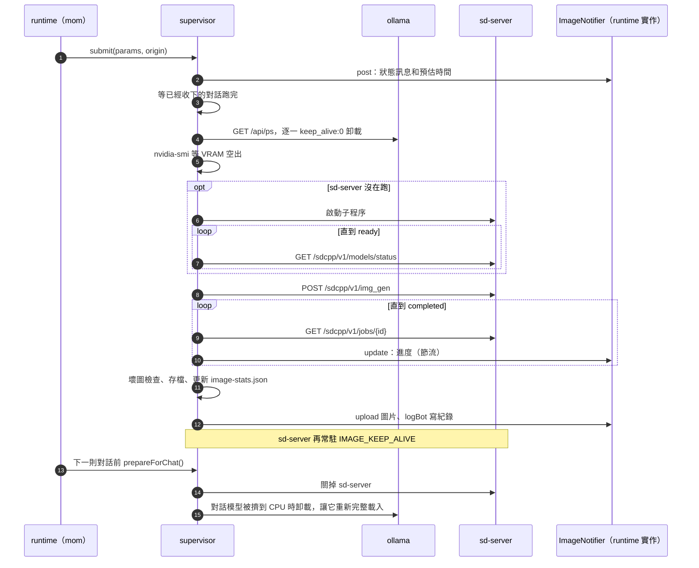

# @pi-mom-local/image-router

本機產圖模組：用 [stable-diffusion.cpp](https://github.com/leejet/stable-diffusion.cpp) 的 `sd-server` 跑 **FLUX.2 Klein 4B**，和對話模型（ollama）**輪流使用同一張 GPU**。設計目標是 6GB VRAM：產圖前先把對話模型從 GPU 卸載，產完再交回去。

不綁定任何聊天介面。發訊息、上傳圖片、失敗時交回 agent，都由 runtime 實作 `ImageNotifier` 傳進來。目前的使用者是 [runtimes/mom](../../runtimes/mom/README.md)（Slack）。在 repo 裡的位置和邊界見 [docs/architecture.md](../../docs/architecture.md)。

- [使用方式](#使用方式)
- [一張圖的流程](#一張圖的流程)
- [檔案導讀](#檔案導讀)
- [設定](#設定)
- [模型檔](#模型檔)
- [本機測試](#本機測試)
- [編譯 sd-server](#編譯-sd-server)
- [實測數據與限制](#實測數據與限制)

## 使用方式

```ts
import { createImageRouter, parseImgCommand, normalizeParams } from "@pi-mom-local/image-router";

const { config, supervisor } = createImageRouter({
	notifier,                       // ImageNotifier：post / update / upload / logBot / failed
	isChatBusy: () => anyChatRunning,
	log: (msg) => console.log(msg),
	// env 預設 process.env，讀 IMAGE_* 設定
});
if (!supervisor) { /* IMAGE_ENABLED 沒開 */ }

// 文字指令 → 參數 → 送出
const params = normalizeParams(parseImgCommand("!img a cat --lora")!, config);
if (typeof params === "string") reply(params);          // 參數錯誤，字串是給使用者看的說明
else supervisor.submit(params, { channelId, userId, source: "command" });

// 對話模型要用 GPU 之前；行程結束時
await supervisor.prepareForChat();
process.on("exit", () => supervisor.shutdownSync());
```

runtime 的責任：

| 責任 | 為什麼 |
| --- | --- |
| 一個行程只建立一次 router | GPU 只有一張，兩個 supervisor 會互搶 |
| 實作 `ImageNotifier` | 狀態訊息、上傳圖片、寫對話紀錄、失敗交回 agent，都依介面而定 |
| 每次跑對話模型前呼叫 `prepareForChat()` | 關掉常駐的 sd-server，讓對話模型完整放回 GPU |
| 產圖中攔截訊息，用 `supervisor.busyReply()`、`controlWord()` 回覆或取消 | 產圖時 GPU 不能給對話用 |
| 行程結束時呼叫 `shutdownSync()` | 不留下孤兒 sd-server（下次啟動時 `createImageRouter` 也會清掉殘留的） |
| 下載使用者上傳的參考圖，用 `toRefImage()` 轉成 `RefImage` | 下載方式依介面而定（mom 用 Slack bot token） |

### 文字指令

`commands.ts` 的格式所有介面共用：

| 指令 | 解析 → 檢查 |
| --- | --- |
| `!img <描述> [--size WxH] [--steps N] [--seed N] [--lora｜--loraN] [--nsfw]` | `parseImgCommand` → `normalizeParams` |
| `!edit <修改說明> [同上，但不能 --nsfw]` + 參考圖 | `parseEditCommand` → `checkEditPrompt`（下載前）→ `normalizeEditParams` |
| `!lora` | `isLoraListCommand` → `formatLoraList` |
| `stop`／`取消`、`等待`／`進度` | `controlWord` |

LoRA 的選法：`--lora` 用 `IMAGE_LORA`（沒設就是 `loras/` 排序第一個），`--loraN` 用第 N 個，超過檔案數時不套用並附上說明（`loraNote`）。`!edit` 不套檔名像 NSFW 的 LoRA，也拒絕裸露、性感化的修改說明。

## 一張圖的流程



`supervisor.submit()` 收下工作後發一則附預估時間的狀態訊息，接著 `run()` 依序執行：

| 步驟 | 做什麼 | 本機實際操作 |
| --- | --- | --- |
| 1. 等對話 | 等已經收下的對話跑完（排進佇列後 runtime 就該拒收新訊息） | 輪詢 `isChatBusy()` |
| 2. 切換 GPU | 卸載 ollama 的模型，等 VRAM 空出 `IMAGE_VRAM_NEED_MB`；不夠就再等一次對話、再卸載一次，還不夠就失敗 | `GET /api/ps`；每個模型 `POST /api/generate {"model":…,"keep_alive":0}`；`nvidia-smi --query-gpu=memory.free` |
| 3. 載入 | sd-server 沒在跑就啟動，等模型就緒 | `spawn` sd-server（參數見 `buildServerArgs`），寫 pidfile 和 log；輪詢 `GET /sdcpp/v1/models/status` 直到 `ready` |
| 4. 產圖 | 送出工作、輪詢進度、更新狀態訊息；處理取消和逾時 | `POST /sdcpp/v1/img_gen`；`GET /sdcpp/v1/jobs/{id}`；取消是 `POST /sdcpp/v1/jobs/{id}/cancel`，等太久就 kill |
| 5. 收尾 | 檢查壞圖、存檔、上傳、寫紀錄、更新預估時間的統計 | 寫 `IMAGE_OUTPUT_DIR/<job>.png`；`notifier.upload()`、`notifier.logBot()`；寫 `$STATE_DIR/image-stats.json` |
| 6. 常駐 | sd-server 再留 `IMAGE_KEEP_ALIVE`，連續產圖不必重新載入；有對話時由 `prepareForChat()` 關掉，並檢查對話模型有沒有被擠到 CPU | `GET /api/ps` 看 `size_vram`；必要時卸載讓它重新完整載入 |

失敗（OOM、逾時、sd-server 結束、壞圖）時關掉 sd-server、釋放 GPU 鎖，再呼叫 `notifier.failed()`，由 runtime 交給 agent 說明原因。

送給 sd-server 的請求（`sd-client.ts`）：

```json
{
  "prompt": "…", "negative_prompt": "", "width": 768, "height": 1024, "seed": 42,
  "sample_params": { "sample_steps": 4, "guidance": { "txt_cfg": 1.0 } },
  "output_format": "png",
  "lora": [{ "path": "loras/xxx.safetensors", "multiplier": 0.6 }, { "path": "nsfw/yyy.safetensors", "multiplier": 1.0 }],
  "ref_images": ["<base64>"],
  "image_preprocess": "target=ref,mode=crop-resize,width=768,height=1024"
}
```

`lora`、`ref_images`、`image_preprocess` 只在需要時出現。LoRA 路徑相對於 `--lora-model-dir`，也就是 `loras/` 和 `nsfw/` 的上一層。

## 檔案導讀

建議照這個順序讀：

| 檔案 | 內容 |
| --- | --- |
| `src/index.ts` | 對外介面和 `createImageRouter()` |
| `src/supervisor.ts` | **核心**。`submit()`、`run()`（上面的步驟 1–6）、`prepareForChat()`、`busyReply()`、狀態訊息的文字 |
| `src/commands.ts` | 文字指令的解析、預設值、範圍檢查、LoRA 選擇、`!edit` 的關鍵字過濾 |
| `src/config.ts` | 所有 `IMAGE_*` 設定、模型和 LoRA 路徑、`listLoras`、`buildServerArgs` |
| `src/gpu.ts` | ollama 卸載、預熱、CPU 佔比；`nvidia-smi` |
| `src/server-process.ts` | sd-server 子程序：啟動、停止、pidfile、log、清殘留 |
| `src/sd-client.ts` | sd-server 的 HTTP API |
| `src/eta.ts` | 預估時間：固定成本 + 每百萬像素，依實測做指數移動平均 |
| `src/png-check.ts` | 全白、全黑、單色等壞圖偵測 |
| `src/ref-image.ts` | 參考圖的格式和尺寸判斷、讀本機圖 |

## 設定

全部從環境變數讀（`config.ts`），範例和說明在 [config/agent.env.example](../../config/agent.env.example)。

| 變數 | 預設 | 用途 |
| --- | --- | --- |
| `IMAGE_ENABLED` | `0` | `1` 才建立 supervisor |
| `IMAGE_SD_SERVER_BIN` | `$STATE_DIR/bin/sd-server` | sd-server 執行檔 |
| `IMAGE_MODEL_DIR` | `$STATE_DIR/models/image/flux2` | 模型資料夾（舊配置 `models/image/` 也認得） |
| `IMAGE_DIFFUSION_MODEL`／`IMAGE_LLM`／`IMAGE_VAE` | 見範例 | 三個模型檔名 |
| `IMAGE_LORA_DIR`／`IMAGE_NSFW_DIR` | `<MODEL_DIR>/loras`、`<MODEL_DIR>/nsfw` | 必須在同一層，否則停用 LoRA（避免 sd-server 掃描過大的資料夾） |
| `IMAGE_LORA`／`IMAGE_LORA_WEIGHT` | 空（排序第一個）／`0.6` | `--lora` 的預設檔案和權重 |
| `IMAGE_NSFW_LORA`／`IMAGE_NSFW_LORA_WEIGHT` | 空（停用）／`1.0` | `--nsfw` 用的 LoRA 檔名，放在 `nsfw/`；留空 = 停用 `--nsfw` |
| `IMAGE_PORT` | `7861` | sd-server 只聽 `127.0.0.1` |
| `IMAGE_RESIDENT_MODE` | `ram` | `ram` 加 `--offload-to-cpu`，權重放 RAM；`vram` 不加 |
| `IMAGE_KEEP_ALIVE` | `10m` | 產完後常駐多久；`0` = 產完就關 |
| `IMAGE_DEFAULT_SIZE`／`IMAGE_DEFAULT_STEPS` | `768x1024`／`4` | 預設尺寸和步數 |
| `IMAGE_MAX_PIXELS`／`IMAGE_MAX_STEPS` | `1048576`／`8` | 上限 |
| `IMAGE_TIMEOUT_FACTOR`／`IMAGE_MIN_TIMEOUT_SEC` | `3`／`180` | 逾時 = max(預估 × 倍數, 最少秒數) |
| `IMAGE_LOAD_TIMEOUT_SEC` | `180` | 模型載入逾時 |
| `IMAGE_VRAM_NEED_MB` | `4500` | 產圖前要空出的 VRAM |
| `IMAGE_OUTPUT_DIR` | `$WORKSPACE/images` | 產出的圖 |
| `IMAGE_SD_EXTRA_ARGS` | 空 | 額外的 sd-server 參數 |

另外會讀 `STATE_DIR`、`WORKSPACE`、`LOG_DIR`、`HOST`、`LLM_MODEL`、`OLLAMA_BASE_URL`，用來決定路徑和要卸載哪個對話模型。

## 模型檔

不在 repo 內。`bin/image-setup.sh` 會下載並比對 sha256，舊的資料夾配置也會自動搬家。NSFW LoRA 預設不下載：`CIVITAI_TOKEN=… bin/image-setup.sh --with-nsfw`，Civitai 要登入才能下載。

```
$STATE_DIR/models/image/flux2/                IMAGE_MODEL_DIR（也是 sd-server 的 --lora-model-dir）
├── flux-2-klein-4b-Q4_0.gguf                 主模型（leejet/FLUX.2-klein-4B-GGUF，Apache-2.0）
├── Qwen3-4B-abliterated.Q4_K_M.gguf          文字編碼器（去審查版，Apache-2.0）
├── flux2-klein-vae.safetensors               VAE（black-forest-labs/FLUX.2-klein-4B）
├── loras/                                    一般 LoRA，可有子資料夾，放進去就能用
└── nsfw/                                     NSFW LoRA（選用），只在 --nsfw 時套用
```

LoRA 必須是 FLUX.2 Klein 4B 用的，Civitai 的 Base Model 標籤是 `Flux.2 Klein 4B`。權重檔一律不進版控，`.gitignore` 已經排除 `*.safetensors`、`*.gguf` 等。

## 本機測試

由淺到深分三層。前一層通過再做下一層，比較容易判斷問題出在哪一段。

### 1. 自動測試（不需要 GPU、不需要模型）

```bash
cd packages/image-router
npm ci          # 第一次
npm test        # 先 build，再跑 test/*.test.ts
```

`test/fixtures/fake-sd-server.mjs` 是一個真的子程序，模擬 sd-server 的 API，有 `ok`、`white`、`oom`、`crash`、`hang`、`cancelable`、`loaderr` 幾種模式。supervisor 的整條流程（切換、載入、進度、取消、逾時、壞圖、失敗回報）都用它測。

### 2. 直接測 sd-server（需要 GPU 和模型，不經過 bot）

確認模型、sd-server、GPU 本身沒問題。以下指令都在 RTX 2060 6GB 上跑過。

**先讓出 GPU。** 對話模型還在 VRAM 裡時，sd-server 會 OOM：

```bash
curl -s localhost:11434/api/ps                       # 看 ollama 載入了什麼
curl -s localhost:11434/api/generate -d '{"model":"<模型名>","keep_alive":0}'   # 逐一卸載
nvidia-smi --query-gpu=memory.used,memory.free --format=csv
```

**啟動 sd-server。** 參數和 router 用的一樣。bot 在跑的話，它的 sd-server 可能佔著 7861，所以這裡改用 7871：

```bash
D=~/.pi-mom-local/models/image/flux2
~/.pi-mom-local/bin/sd-server --listen-ip 127.0.0.1 --listen-port 7871 \
  --diffusion-model $D/flux-2-klein-4b-Q4_0.gguf --llm $D/Qwen3-4B-abliterated.Q4_K_M.gguf \
  --vae $D/flux2-klein-vae.safetensors --cfg-scale 1.0 --steps 4 --offload-to-cpu \
  --lora-model-dir $D
```

**另開一個終端機送請求：**

```bash
U=http://127.0.0.1:7871
curl -s $U/sdcpp/v1/models/status | jq .state                 # 等到 "ready"

ID=$(curl -s -X POST $U/sdcpp/v1/img_gen -H 'Content-Type: application/json' \
  -d '{"prompt":"a lighthouse on a cliff at sunset","width":512,"height":512,"sample_params":{"sample_steps":4},"seed":42}' | jq -r .id)

watch -n2 "curl -s $U/sdcpp/v1/jobs/$ID | jq -c '{status, progress}'"   # queued → generating → completed

curl -s $U/sdcpp/v1/jobs/$ID | jq -r '.result.images[0].b64_json' | base64 -d > test.png
```

**其他要驗的：**
- **LoRA：** 請求加上 `"lora":[{"path":"loras/<檔名>.safetensors","multiplier":0.6}]`。sd-server 的輸出應該出現 `LoRA tensors have been applied, lora_file_path = …`。
- **取消：** 產圖中送 `curl -s -X POST $U/sdcpp/v1/jobs/$ID/cancel -d '{}'`，狀態會在下一步結束時變成 `cancelled`。

參考時間：512×512、4 步、模型已載入時約 16 秒。測完記得關掉 sd-server（Ctrl-C）。

### 3. 透過 runtime 的完整測試

以 mom 為例：

```bash
bin/status.sh                                     # bot、sd-server、VRAM、預估時間統計
tail -f ~/.pi-mom-local/logs/sd-server.log         # sd-server 的輸出
tail -f ~/.pi-mom-local/logs/mom.log | grep '\[image\]'
```

在 Slack 依序測：

| # | 輸入 | 預期 |
| --- | --- | --- |
| 1 | `!lora` | 列出 `loras/` 的編號（或說沒有 LoRA） |
| 2 | `!img a cat on the beach` | 狀態訊息 → 進度 → 貼圖；第一張含載入約 50–60 秒 |
| 3 | 產圖中打 `進度`，另一張產圖中打 `stop` | 回進度；取消並回「已取消」 |
| 4 | `!img a cat --lora` | sd-server.log 出現 LoRA 已套用 |
| 5 | 上傳照片，同一則打 `!edit 加上一頂帽子` | 貼出修改後的圖 |
| 6 | 不附照片打 `!edit 背景換成雪山` | 改上一張圖 |
| 7 | 產完後跟 bot 聊天 | sd-server 被關掉、對話速度正常（`ollama ps` 顯示 100% GPU） |

## 編譯 sd-server

stable-diffusion.cpp 的 release 沒有 Linux CUDA 版，要自己編譯。下面是 WSL2 + RTX 2060（sm_75）實際用過的步驟，使用的版本是 commit `532d2c1`：

```bash
sudo apt install cuda-toolkit-12-8          # NVIDIA 的 WSL 套件庫；nvcc 不會自動加進 PATH
git clone --recursive https://github.com/leejet/stable-diffusion.cpp ~/.pi-mom-local/build/stable-diffusion.cpp
cd ~/.pi-mom-local/build/stable-diffusion.cpp
cmake -B build-cuda -DSD_CUDA=ON \
  -DCMAKE_CUDA_COMPILER=/usr/local/cuda-12.8/bin/nvcc -DCUDAToolkit_ROOT=/usr/local/cuda-12.8 \
  -DCMAKE_CUDA_ARCHITECTURES=75             # 75 = RTX 20 系列，依顯示卡調整
cmake --build build-cuda -j4 --target sd-server sd-cli       # 約 40 分鐘
cp build-cuda/bin/sd-server build-cuda/bin/sd-cli ~/.pi-mom-local/bin/
```

- **CUDA 路徑要明確指定：** WSL 的 PATH 裡常有 Windows 帶進來的舊版 CUDA，cmake 會抓錯。
- **改用 12.8：** 上游 release 用 12.8 編譯，cmake 3.22 搭配 13.x 沒有人驗證過。

## 實測數據與限制

RTX 2060 Max-Q（30W、6GB），CUDA 12.8 自行編譯：

| | 時間 | VRAM 峰值 |
|---|---|---|
| 768×1024，4 步（模型已常駐） | 38 秒 | 3.4GB |
| 1024² | 51 秒 | 3.9GB |
| 冷啟動 512² | 46–60 秒 | 2.9GB |
| 768×1024 + NSFW LoRA | 52 秒 | 4.17GB |
| `!edit` 768×1024 | 約 73 秒 | |

- **ram 模式：** sd.cpp 把權重放在 RAM（約 4.9GB），閒置時仍佔約 0.6GB VRAM。這會把對話模型擠一部分到 CPU，回覆慢好幾倍，所以有對話時一律關掉 sd-server。
- **取消：** 要等到目前這一步結束才生效。等超過 max(10 秒, 1.5 步 + 5 秒) 就直接 kill。
- **`!edit` 的關鍵字過濾：** 只是盡力而為，不是完整的內容審查。
- **同時只跑一張：** 全域只有一個 GPU 鎖。
