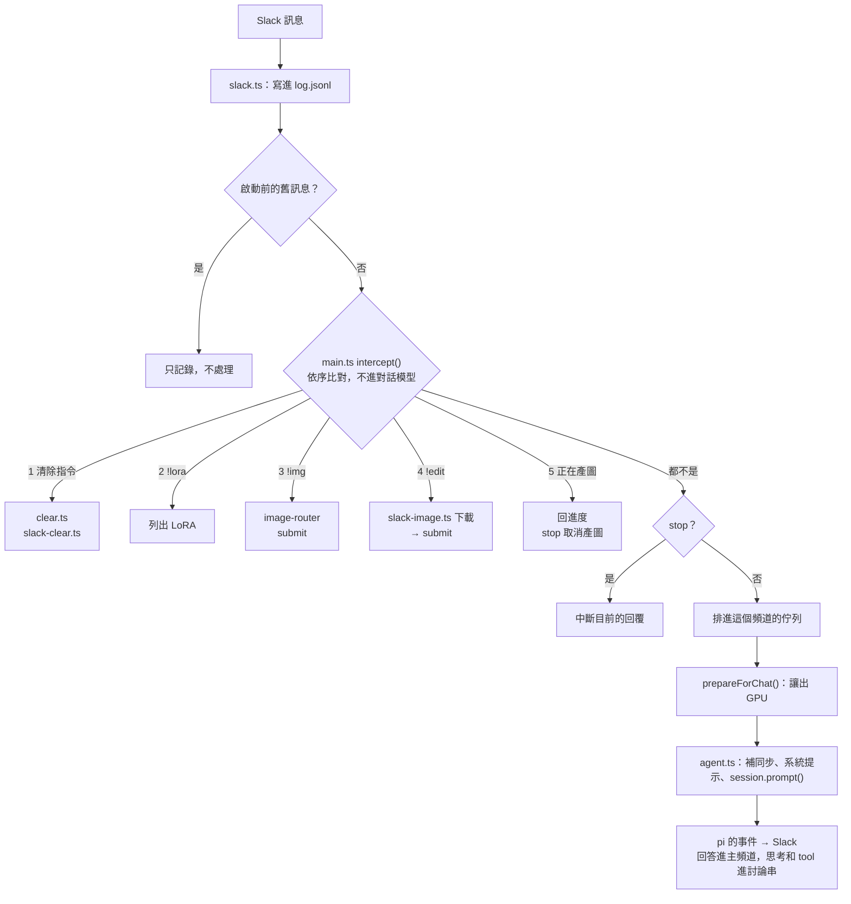

# runtime: mom

Slack ↔ agent 的橋：收 Slack 事件、組 prompt、呼叫本機的對話模型、把工具呼叫送進沙箱、把回應送回 Slack。另外處理不經過對話模型的指令：產圖、改圖、清除。

給 review 和維護的人看。使用方式見根目錄 [README](../../README.md)；repo 怎麼分層、這個 runtime 和 `packages/` 的關係見 [docs/architecture.md](../../docs/architecture.md)。

- **來源：** 衍生自 pi-mono 的 `packages/mom` 0.70.6。和上游的差異見 [NOTICE](../../NOTICE)，上游原本的說明保留在 [UPSTREAM-README.md](UPSTREAM-README.md)。
- **依賴：** `@mariozechner/pi-agent-core`、`pi-ai`、`pi-coding-agent`（npm 發行版，未修改），以及 repo 內的 [`@pi-mom-local/image-router`](../../packages/image-router/README.md)。

## 契約

`bin/start.sh` 讀 `config/agent.env` 之後，透過環境變數呼叫 `./start`：

| 變數 | 用途 |
| --- | --- |
| `CHANNELS_DIR` | mom 的 workingDir，每個頻道一個資料夾 |
| `WORKSPACE` | 掛進沙箱容器的 `/workspace`；產出的圖在 `images/` |
| `PI_HOME` | 隔離用的 `HOME`，agent 讀不到使用者的憑證 |
| `SANDBOX`、`SANDBOX_IMAGE` | `host` 或 `docker:<容器名>`；沙箱 image |
| `MOM_MODELS_JSON`、`LLM_PROVIDER`、`LLM_MODEL` | 對話模型 |
| `MOM_SLACK_APP_TOKEN`、`MOM_SLACK_BOT_TOKEN` | Slack 憑證 |
| `SEARCH_PROVIDER`、`BRAVE_SEARCH_API_KEY`、`TAVILY_API_KEY` | `search` 工具 |
| `IMAGE_*` | 產圖設定，直接交給 image-router（見[套件的設定表](../../packages/image-router/README.md#設定)） |

`./build` 是冪等的：先建置 `packages/*`，再建置 mom。`package.json` 或 lock 檔比上次安裝新時，會用 `npm ci` 重裝。**mom 跑的是 `dist/`，改完 `src/` 一定要重新建置。**

## 一則訊息怎麼走



`intercept()` 依序檢查，第一個符合的就處理掉，各自對應的程式：

| 順序 | 條件 | 處理 | 程式 |
| --- | --- | --- | --- |
| 1 | `/clear`、`/clear-record`、`!clear-slack`、`!clear-all` | 清除對話記憶、本機紀錄、Slack 訊息 | `clear.ts`、`slack-clear.ts`，見 [docs/clear-commands.md](docs/clear-commands.md) |
| 2 | `!lora` | 列出 LoRA 編號 | image-router 的 `formatLoraList` |
| 3 | `!img` | 直接產圖 | image-router 的 `parseImgCommand` → `normalizeParams` → `submit` |
| 4 | `!edit` | 下載參考圖後改圖 | `slack-image.ts` 下載 → image-router 的 `normalizeEditParams` → `submit` |
| 5 | 產圖中的任何訊息 | 回進度；`stop`／`取消` 中斷 | image-router 的 `controlWord`、`busyReply` |

產圖在 mom 裡的接法：

| 檔案 | 做什麼 |
| --- | --- |
| `src/image-router.ts` | 建立並保管唯一的 router（`initImageRouter`），行程結束時收掉 sd-server |
| `main.ts` 的 `initImageRouter({ notifier })` | 把 Slack 接到 `ImageNotifier`：發和更新狀態訊息、上傳圖片、寫 `log.jsonl`、失敗時排一個 `[IMAGE_JOB_FAILED]` 事件讓 agent 說明 |
| `src/slack-image.ts` | 判斷附檔是不是圖、用 bot token 下載（優先 `thumb_1024`，Slack 已依 EXIF 轉正）；記錄每個頻道「最近一張圖」，`!edit` 沒附照片時使用 |
| `src/tools/image.ts` | `generate_image` 工具：agent 自己決定產圖時用；不阻塞，立刻回傳預估時間 |
| `src/turn-hint.ts`、`agent.ts` 的系統提示 | 告訴模型現在可以產圖，壓過舊對話裡「無法產圖」的回答 |

## 檔案地圖

| 檔案 | 內容 |
| --- | --- |
| `src/main.ts` | 進入點：參數、頻道狀態、`intercept()`、執行 agent、產圖和清除的接線 |
| `src/slack.ts` | Socket Mode 連線、事件、補抓離線訊息、發送和上傳；清除用的 `collectOwnMessages`／`deleteOwnMessages` |
| `src/agent.ts` | 建立 pi agent（模型、系統提示、工具、session），把事件串流回 Slack |
| `src/context.ts` | `log.jsonl` → 對話記憶的補同步；尊重 `/clear` 的清除範圍 |
| `src/compaction-guard.ts` | 避免和清掉 pi 產生的空摘要 |
| `src/store.ts`、`src/download.ts` | 頻道資料夾、附件下載；匯出頻道歷史 |
| `src/events.ts`、`src/fs-watch.ts` | 排程事件（`workspace/events/`）；也用來把產圖失敗交回 agent |
| `src/clear.ts`、`src/slack-clear.ts` | 清除指令 |
| `src/image-router.ts`、`src/slack-image.ts` | 產圖的 Slack 接線（見上） |
| `src/sandbox.ts` | 工具在 host 或 docker 容器裡執行 |
| `src/mrkdwn.ts`、`src/time.ts`、`src/turn-hint.ts`、`src/log.ts` | 格式、時間戳、提醒、log |
| `src/tools/` | `read`、`bash`、`edit`、`write`、`attach`、`search`、`fetch`、`generate_image`（只在 `IMAGE_ENABLED=1` 時註冊） |
| `docs/clear-commands.md` | 清除指令的設計 |
| `docs/*.md`（其他） | 上游留下的英文文件（events、sandbox、artifacts-server 等），描述的是上游版本 |

## 測試

```bash
cd runtimes/mom
npm test          # 先建置（含 packages/*），再跑 test/*.test.ts 和 test/*.test.mjs
```

| 測試 | 涵蓋 |
| --- | --- |
| `clear.test.mjs`、`clear-slack.test.mjs` | 清除指令解析、範圍、截斷、補同步、Slack 刪除順序和錯誤容忍 |
| `slack-image.test.mjs` | 挑圖片附檔、用 bot token 下載、本機圖 |
| `context-sync.test.mjs`、`compaction-guard.test.mjs`、`mrkdwn.test.mjs` | 補同步、空摘要、格式轉換 |
| `events.test.ts` | 上游的測試，需要 vitest；目前沒有安裝，會失敗 |

產圖本身的測試在 `packages/image-router`（`npm test`，用假的 sd-server，不需要 GPU）。要在真的 GPU 上測，見[套件的本機測試](../../packages/image-router/README.md#本機測試)。

repo 根目錄的 `tests/*.sh` 是 shell 層的測試（watchdog、Socket Mode 健康度、skills）。

## 已知限制

- **`.env` 不會自動載入。** `src/main.ts` 直接讀 `process.env`，由 `bin/lib.sh` 的 `load_config()` 負責 source `config/agent.env`。
- **忽略所有 bot 訊息**（`slack.ts`）。所以沒辦法用另一個 bot 做自動化的端對端測試，Slack 上的測試要真人操作。
- **對話記憶會一直長。** pi 會在接近 `contextWindow` 時壓縮成摘要，`compaction-guard.ts` 擋掉空摘要；`contextWindow` 還是要和模型主機的實際設定一致，否則會被靜默截斷（見 RUNBOOK「agent 的行為不對」）。
- **「頻道最近一張圖」只放在記憶體。** 重啟後 `!edit` 要重新附照片。
