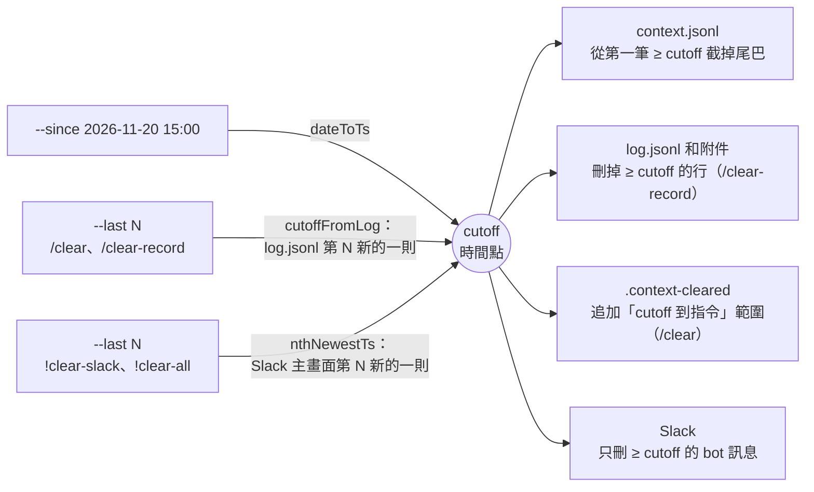

# 清除指令的設計

`/clear`、`/clear-record`、`!clear-slack`、`!clear-all`：使用方式見根目錄 [README](../../../README.md#清除對話)。這份給 review 和維護的人看：清的是哪些資料、範圍怎麼算、為什麼這樣做。

## 每個指令清什麼

| 指令 | 對話記憶 `context.jsonl` | 本機紀錄 `log.jsonl`、`attachments/` | Slack 上 bot 的訊息 | 「最近一張圖」 | `MEMORY.md` |
| --- | --- | --- | --- | --- | --- |
| `/clear` | 清 | 留，但記下清除範圍 | 留 | 留 | 留 |
| `/clear-record` | 清 | 清 | 留 | 清 | 留 |
| `!clear-slack confirm` | 留 | 留 | 刪 | 留 | 留 |
| `!clear-all confirm` | 清 | 清 | 刪 | 清 | 留 |

- **`MEMORY.md` 一律保留：** 它是 bot 刻意寫下的長期筆記，不是對話紀錄。
- **`last_prompt.jsonl` 也會清掉：** 它是除錯用的檔案，每個會清記憶的指令都一起清。
- **記憶體裡的 runner 和頻道狀態一起丟掉（`dropRunner`）：** 否則下一則訊息還會用舊的 session。

## 範圍：`--since`、`--last`

四個指令都能加一個範圍，不加就是全部。



範圍**一律換算成一個時間點 `cutoffTs`（Slack ts 格式），清掉那個時間點到現在的所有東西**。只從尾巴截掉，所以留下的前段一定是完整的對話，不會出現缺一段的情況。

| 參數 | 換算 |
| --- | --- |
| `--since 2026-11-20 [HH:MM]` | 本機時區的那個時刻（`dateToTs`）。只寫月日時當作今年，如果比現在晚就算去年 |
| `--last N`，用於 `/clear`、`/clear-record` | `log.jsonl` 從新到舊第 N 則的 ts（`cutoffFromLog`），你和 bot 的訊息都算 |
| `--last N`，用於 `!clear-slack`、`!clear-all` | Slack 主畫面從新到舊第 N 則的 ts（`nthNewestTs`）。討論串回覆跟著主訊息走，不另外算 |

**清除指令本身和 bot 的確認說明不算在 N 裡**（`isClearNoise`）。不然先打 `!clear-all --last 10`、bot 回說明、再打 confirm，這 10 則裡就有 3 則是這些指令。

`!clear-all` 用 Slack 那側算出的 `cutoffTs` 清本機，兩邊的範圍才會一致。

## 本機怎麼清（`clear.ts`）

### 對話記憶：從尾巴截斷

`context.jsonl` 是 pi 的 session 檔：第一行是 `session` 標頭，之後每筆的 `parentId` 指向前一筆，形成一條鏈。`truncateContext` 找到第一筆 `timestamp >= cutoff` 的紀錄，把它和之後的全部丟掉。保留的是前段，所以不會有指向已刪除紀錄的參照；全部丟光時直接刪檔。

用每筆紀錄的處理時間比對，不是訊息原本的時間。補同步進來的舊訊息會排在後面，所以也會被截掉；但它們在清除範圍外，下一輪會從 `log.jsonl` 再補回來，結果仍然正確。

### `/clear` 的清除範圍：`.context-cleared`

`/clear` 不刪 `log.jsonl`。但每一輪對話開始前，`syncLogToSessionManager` 會把 `log.jsonl` 裡不在記憶中的使用者訊息補回去，所以必須記下哪些不能補。

`.context-cleared` 每一行是一個範圍，`context.ts` 補同步時跳過落在任何範圍內的訊息：

```
1795168800.000200                       ← 舊格式：這個 ts 以前全部
1795168860.000300 1795168900.000000     ← from to：--since/--last 清掉的區段
```

- **`/clear` 不加範圍：** 整個檔案改寫成一行，就是下指令那則訊息的 ts，蓋掉之前的範圍。
- **`/clear` 加範圍：** 追加一行「cutoff 到下指令那則」。
- **`/clear-record`：** 會刪掉 `log.jsonl` 裡範圍內的那幾行，不需要記範圍；不加範圍時連 `.context-cleared` 一起刪。

### `/clear-record` 的附件

`log.jsonl` 每一行的 `attachments[].local` 是相對於 working dir 的路徑。範圍清除時，只刪被刪掉的那幾行引用、而且確實位在這個頻道 `attachments/` 底下的檔案。

## Slack 怎麼刪（`slack-clear.ts`）

- **權限：** bot token 只能刪 bot 自己的訊息（`chat.delete`）和自己上傳的檔案（`files.delete`）。使用者的訊息要使用者自己刪。用現有的 scope 就夠，不用重裝 app。
- **`collectOwnMessages`：** 分頁讀 `conversations.history`（有範圍時加 `oldest`），有回覆的主訊息再分頁讀 `conversations.replies`。收集 `user` 是 bot 或 `bot_id` 是 bot 的訊息，跳過已刪除的空殼（`tombstone`）和別人上傳的檔案。
- **順序：** 每個討論串先刪回覆再刪主訊息，避免留下「此訊息已刪除」的空殼；同一則訊息先刪檔案再刪訊息。
- **錯誤：** `message_not_found`、`file_not_found`、`file_deleted` 視為已經刪掉；其他錯誤記下來，繼續刪下一則。
- **速率：** `chat.delete` 每分鐘約 50 次，由 `@slack/web-api` 內建的 429 重試處理。狀態訊息每 10 秒更新一次進度，完成通知 1 分鐘後自動刪除。
- **在背景執行：** 同一頻道不會同時跑兩個（`clearingSlack`），刪除中 `/clear`、`/clear-record` 照常可以用。

## 安全設計

- **Slack 那側要再打 confirm：** `!clear-slack`、`!clear-all` 第一次只回說明，附上可以直接複製的完整 confirm 指令（含範圍）。刪了無法復原。
- **bot 在忙時拒絕執行：** bot 正在回覆或產圖時，四個指令都拒絕，避免和正在寫入的 session 互相干擾。
- **打錯參數時直接回用法：** 不交給對話模型，避免模型「猜」使用者的意思。
- **`!clear-all` 最後才清本機：** 等 Slack 刪完才做 `/clear-record`，清除過程中打的指令也會一起從 `log.jsonl` 消失。

## 測試

`test/clear.test.mjs`、`test/clear-slack.test.mjs`（`npm test`）涵蓋：
- 指令和參數解析、日期換算
- 對話記憶截斷、範圍疊加、補同步
- `--last` 的換算和不算在 N 裡的訊息
- 附件刪除
- Slack 分頁、刪除順序、錯誤容忍

Slack 上的實測要真人操作，因為 bot 會忽略所有 bot 發的訊息。
